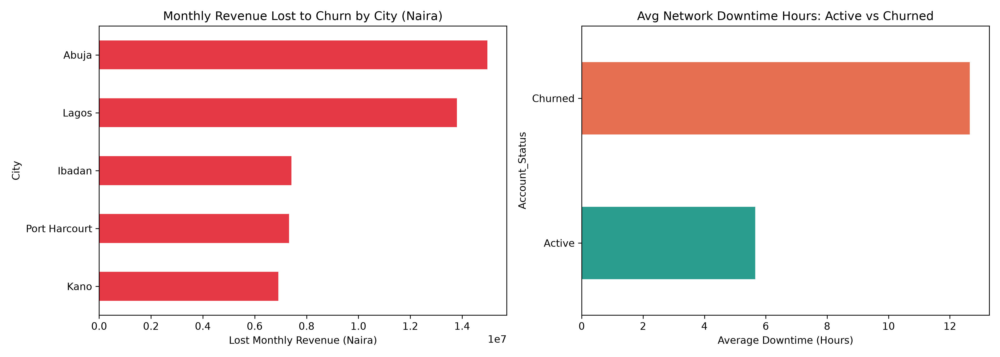

# 📡 Nigerian Telecoms (15,000 Customers): Python Data Cleaning, EDA & Machine Learning Churn Prediction
### 🚀 [Click Here to Launch the Live Interactive Streamlit ML Web App!](https://nigeria-telecom-15k-churn-python-and-machine-learning-suwci4w3.streamlit.app)
**Tools Used:** Python (`Pandas`, `NumPy`, `Matplotlib`, `Scikit-Learn`) | Jupyter Notebook (`.ipynb`) | Random Forest Classifier (`84.60% Accuracy`)

## 📌 Executive Summary
Analyzing customer retention across **15,000 telecom subscribers** (**MTN, Airtel, Glo, and 9mobile**) generating **₦156.57 Million** in monthly recurring revenue across major Nigerian cities (Lagos, Abuja, Port Harcourt, Ibadan, and Kano). 

Using **Python in Jupyter Notebook**, I built a complete data-cleaning pipeline to handle missing values and text inconsistencies, performed exploratory data analysis (EDA), and trained a **Scikit-Learn Random Forest Machine Learning Model** to predict customer churn and quantify the exact operational drivers of subscriber loss.

---

## 📊 Exploratory Data Analysis Visuals (`Matplotlib`)

---

## 🧹 Step 1: Python Data Cleaning & Feature Engineering (`Pandas` & `NumPy`)
1. **Missing Value Imputation (`.fillna()`):** Audited all 15,000 records using `df.isnull().sum()`, identifying **250 missing (`NaN`) records** in `Monthly_Spend_Naira`, which were imputed using the median subscriber spend to prevent skewing.
2. **String Standardization (`.str.strip().str.title()`):** Cleaned inconsistent city strings (e.g., `'  lagos '`, `'ABUJA '`) into standardized title-case city labels.
3. **SLA Feature Engineering (`np.where()`):** Created a conditional SLA risk feature flagging subscribers experiencing **`>12 hours`** of monthly network downtime (`Critical_Downtime (>12h)` vs. `Normal (<12h)`).

---

## 🔍 Step 2: Key Business & Statistical Insights (15,000 Subscribers)
- **Market Revenue & Churn Distribution:**
  - **MTN:** 6,387 subscribers (₦67.12M/mo revenue) — `32.30%` churn rate
  - **Airtel:** 4,630 subscribers (₦47.83M/mo revenue) — `32.63%` churn rate
  - **Glo:** 2,778 subscribers (₦28.56M/mo revenue) — `32.11%` churn rate
  - **9mobile:** 1,205 subscribers (₦13.07M/mo revenue) — `31.20%` churn rate
- **The 12-Hour Network Downtime Cliff:**
  - Subscribers with **Normal Downtime (`<12 hours/mo`)** maintained an **80.58% Active retention rate** (only `19.42%` churn).
  - Subscribers exposed to **Critical Downtime (`>12 hours/mo`)** suffered a massive **78.18% churn rate** (4x higher churn likelihood).

---

## 🤖 Step 3: Predictive Machine Learning (`Scikit-Learn` Random Forest)
- Split the 15,000-row dataset into **80% Training (12,000 subscribers)** and **20% Testing (3,000 unseen subscribers)** using `train_test_split`.
- Trained a **Random Forest Classifier (`n_estimators=100, max_depth=6`)**, achieving **`84.60%` out-of-sample churn prediction accuracy**.
- **Feature Importance Breakdown (What Actually Drives Churn?):**
  1. **`Network_Downtime_Hours`:** **`66.83%`** importance
  2. **`Dropped_Calls_Monthly`:** **`30.89%`** importance
  3. **`Tenure_Months`:** **`1.24%`** importance
  4. **`Customer_Support_Calls`:** **`0.60%`** importance
  5. **`Monthly_Spend_Naira` (Price):** **`0.43%`** importance

---

## 💡 Strategic Recommendations
1. **Price Discounts Won't Fix Churn (Focus on Infrastructure):** Machine learning feature importance proves that tariff pricing (`Monthly_Spend_Naira`) accounts for only **0.43%** of churn, while **Network Downtime (`66.83%`)** and **Dropped Calls (`30.89%`)** drive **97.72%** of subscriber exits.
2. **Automated Proactive Retention Trigger:** Deploy the trained Random Forest model to score subscribers weekly; automatically issue a free 5GB apology data bonus whenever a subscriber's monthly network downtime crosses **10 hours** (before they hit the 12-hour `78.18%` churn cliff).
